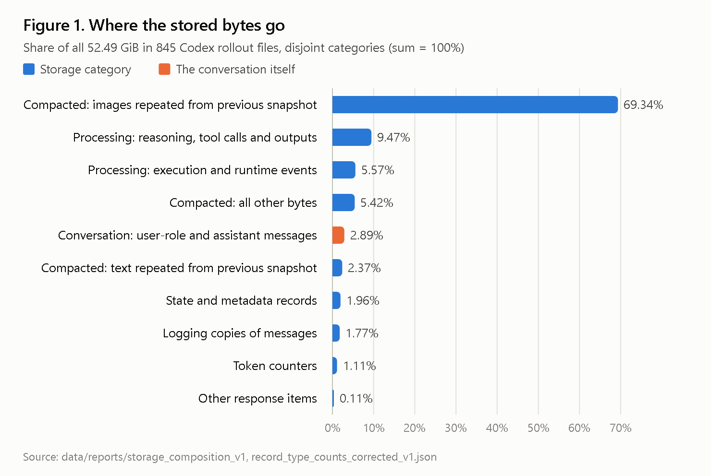
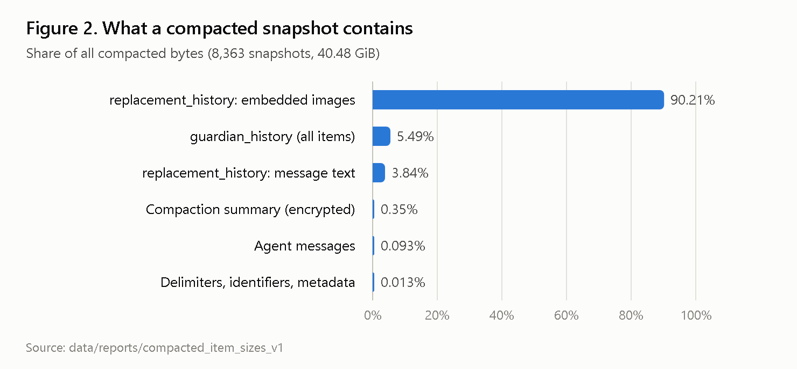
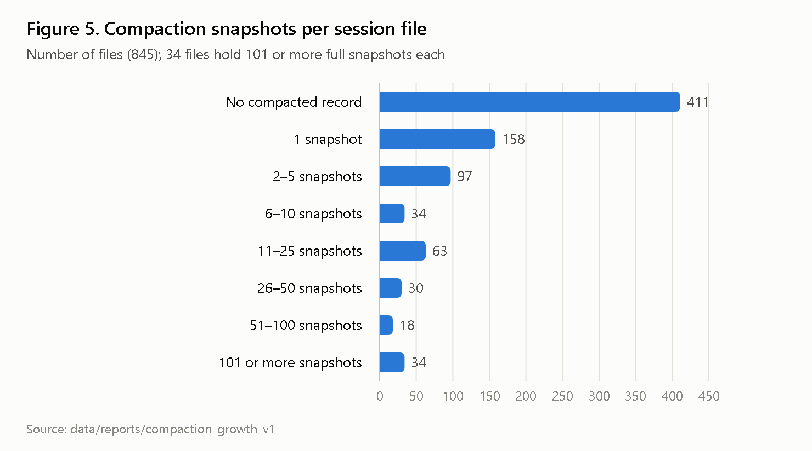
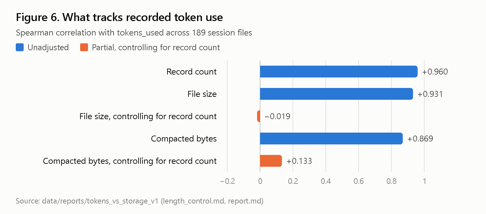
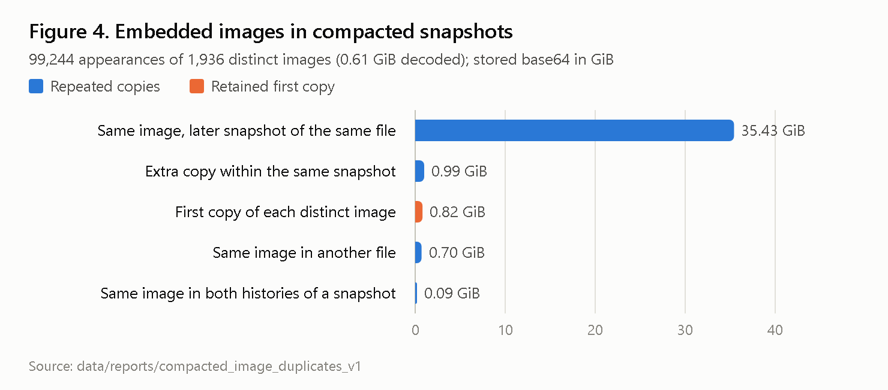
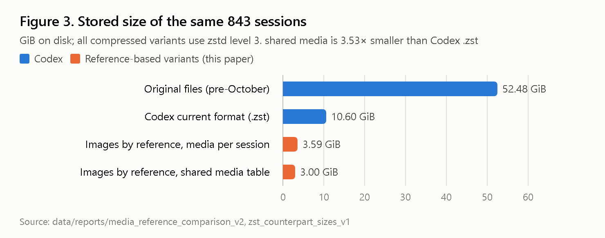

# Session Storage Amplification in Long-Horizon Coding Agents

**Measurement, Compaction, and a Reference-Based Persistence Architecture**

Eng Rassam · October 2026 · Independent Research — Submitted for Consideration by OpenAI
Research Release v1.0

📄 [Paper (PDF)](paper/paper.pdf) · [Paper (Markdown)](paper/paper.md) ·
[Methodology](methodology/measurement-methodology.md) · [Limitations](methodology/limitations.md) ·
[Aggregate results](results/)

## Research objective

Codex persists a local rollout file for every session, so that work can be resumed: messages,
tool activity, execution events, token counters and compacted replacements of the context. This
study asks four questions:

- What occupies that storage?
- Why does it grow?
- How does it relate to recorded token use?
- How much smaller would a design be that stores content once and references it?

## Executive summary

We measured every stored byte of 845 Codex rollout files (52.49 GiB, January–October 2026) from
one developer's real work, without reading or reproducing any content. Each statement in the
paper is labelled **[O]** Observed, **[I]** Inferred, **[H]** Hypothesized or **[P]** Proposed.

- **[O] Compaction dominates.** Compaction snapshots account for 77.13% of stored bytes. The
  user-role and assistant conversation accounts for 2.89%, and 0.64% without embedded images.
- **[O] Snapshots repeat their predecessors.** 92.98% of compacted bytes are images or text
  blocks already present in the preceding snapshot; images alone are 69.34% of the whole corpus.
- **[O] Tokens show no association with file size.** After controlling for session length, file
  size has no association with recorded token use. This is correlational evidence.
- **[O] Codex's October 2026 changes.** On 843 files, Codex's own rewrite and compression reduce
  52.48 GiB to 10.60 GiB.
- **[O] A reference-based variant.** Images stored once in a media table shared across sessions,
  with the same zstd level, measure 3.00 GiB. See the comparison conditions below.

## Key findings

| Finding | Measurement | Scope |
|---|---|---|
| Compaction snapshots, share of stored bytes | 77.13% | corpus, 845 files |
| Images already present in the previous snapshot, share of stored bytes | 69.34% | corpus |
| Compacted bytes already present in the previous snapshot (images 89.91%, text 3.07%) | 92.98% | corpus |
| Unchanged items between consecutive snapshots | ~98% (270–271 of 275–279) | three-snapshot sample, one session |
| Conversation (user-role and assistant), share of stored bytes | 2.89% (0.64% without images) | corpus |
| Stored bytes ÷ conversation bytes | 34.6× (median per file 14.7×) | corpus; 792 files with a non-zero baseline for the median |
| Embedded image occurrences ÷ distinct images | 106,260 ÷ 3,969 | corpus, all record types |
| Median compaction duration | 56.5 s (n = 755); ρ = 0.089 with snapshot size | events with both timestamps |
| File size vs `tokens_used`, controlling for record count | partial Spearman −0.019 (n = 189) | files ending before 19 June 2026 |
| Logged usage rows flagged as possible duplicates | 27.1% | 1,778,473 observations |
| Codex `.zst` after its October 2026 rewrite | 10.60 GiB | 843 matched files |
| Images by reference, shared media table, zstd-3 | 3.00 GiB (3.53× smaller than Codex `.zst`) | 843 matched files; conditions below |

**Comparison conditions for 10.60 GiB vs 3.00 GiB.**
- The Codex baseline is Codex's stored `.zst` after its October 2026 legacy rewrite and zstd
  compression.
- The reference-based variant was computed from the pre-October original files.
- The 843 pairs were matched by file name. Modification times were not independently verified.

The 3.53× figure is therefore a measured size ratio under this methodology, not a controlled
end-to-end production comparison. On six files where both sides start from the same
post-rewrite input, the variant measured 1.34× to 11.15× smaller (4.89× in total); see paper
Section 14.3.

## Important limitations

- **One user.** The corpus comes from one heavy user on one machine. Shares describe this
  workload and are not population estimates.
- **Bytes, not tokens.** The storage results do not imply token or cost savings.
- **Diagnostic cases.** Token findings beyond the correlation rest on a few diagnostic cases.
  For example, the full resend after compaction was observed in one reconstructed turn; its
  general frequency was not measured.
- **Not measured.** Resume memory and latency, context equivalence after the October rewrite,
  and the token effect of the proposed designs.
- **Inferred, not observed.** Which compaction path (local or remote) runs in practice.

Full list: [methodology/limitations.md](methodology/limitations.md).

## Figures

| | |
|---|---|
|  |  |
| **Fig. 1.** Share of all stored bytes by disjoint functional category (845 files). | **Fig. 2.** Share of compacted bytes by part (8,363 snapshots). |
|  |  |
| **Fig. 3.** Files by number of compacted snapshots (845 files). | **Fig. 4.** Spearman correlation with `tokens_used`, 189 files; correlations, not causal effects. |
|  |  |
| **Fig. 5.** Stored image bytes in compacted histories by duplicate category. | **Fig. 6.** Stored size of 843 matched files; comparison conditions above. |

## Aggregate results

- [`results/aggregated-metrics.json`](results/aggregated-metrics.json): every headline number,
  each with the report it comes from and the notes needed to interpret it.
- [`results/comparison-summary.csv`](results/comparison-summary.csv): the Codex format against the
  reference-based variants, for the corpus and for the six study files.

## Proposed engineering improvements

These are proposals; their effects beyond storage are not yet measured (paper Section 17).

1. **Content-addressed media shared across sessions.** Rollouts keep only a short reference to
   each image.
2. **Snapshots by reference.** Store compaction snapshots in a separate store, as item references
   or deltas, and keep only the latest one for resume.
3. **Parent references for all inherited history.** Extend the October subagent mechanism to
   forks and resumes.
4. **Incremental and prefix-stable compaction.** Avoid whole-context summarization and the full
   resend that can follow it.
5. **Segmented compression.** Appends do not decompress the whole file.
6. **Accounting transparency.** Report cached and uncached input separately, log each usage once,
   and keep per-request manifests of input composition.
7. **A project-level side memory file.** Built incrementally, with links to its sources, as a
   complement to context and compaction rather than a replacement.

## Reproducibility status

| Component | Status |
|---|---|
| Paper, figures, aggregate results | Public in this repository |
| Figures from aggregate numbers | Reproducible with `scripts/make_figures.py`; every plotted value appears in `results/` or in the paper tables |
| Analysis scripts, migrations and synthetic tests | Public in [scripts/](scripts/) and [database/](database/); 225 tests run without private data |
| Re-running the measurements | Requires the private session files, which are not published |
| Codex code behaviour cited | Public: `openai/codex` at tag `rust-v0.164.0`; links in the paper's References |

## Data privacy

All measurements were made on the author's own sessions, from read-only copies, by streaming
scripts that kept only byte counts, hashes, structural field paths and counters. The repository
contains no conversation text, images, commands, file paths or session identifiers. It was
scanned for identifiers, paths, email addresses, base64 data and secret-like strings before
release.

Paths such as `data/reports/...` cited in the paper refer to the author's private working
reports. Their aggregates are published in `results/`.

## Citation

Please cite using [CITATION.cff](CITATION.cff):

> Eng Rassam. *Session Storage Amplification in Long-Horizon Coding Agents: Measurement,
> Compaction, and a Reference-Based Persistence Architecture.* Research Release v1.0,
> October 2026. https://github.com/techsoftye/codex-session-storage-researchs

## License

The paper, figures, results and documentation are released under CC BY 4.0 (see
[LICENSE](LICENSE)). The source code in `scripts/` and `database/` is released under the MIT
License (see [LICENSE-CODE](LICENSE-CODE)).

## Feedback

Technical feedback is welcome, particularly from Codex maintainers, and especially on the
compaction path used in practice, resume behaviour, and the comparison conditions above. Please
open an issue in this repository.
